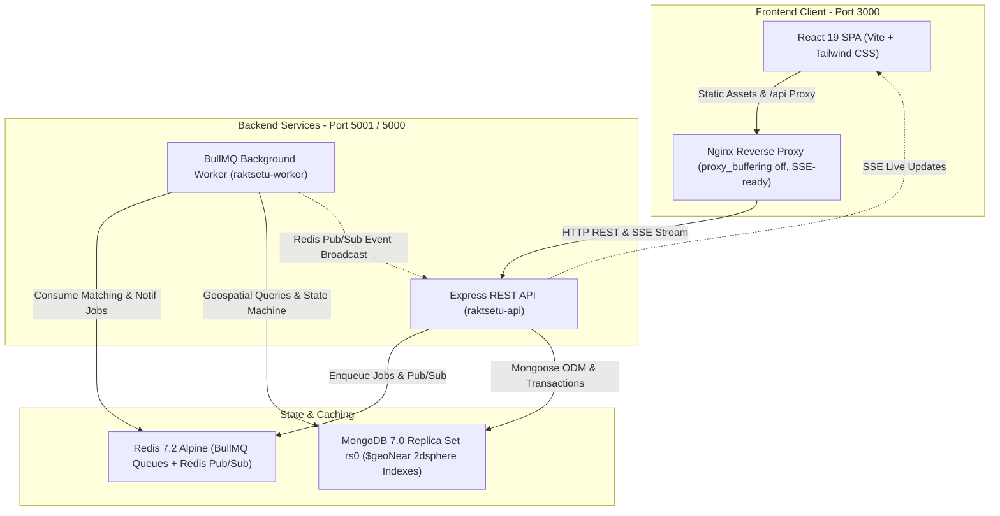
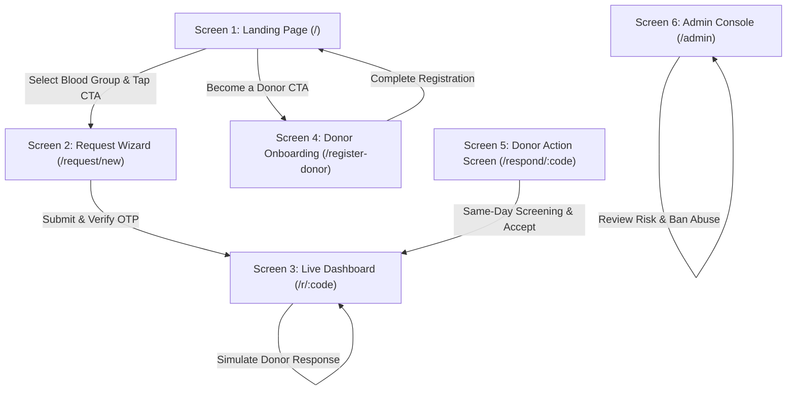
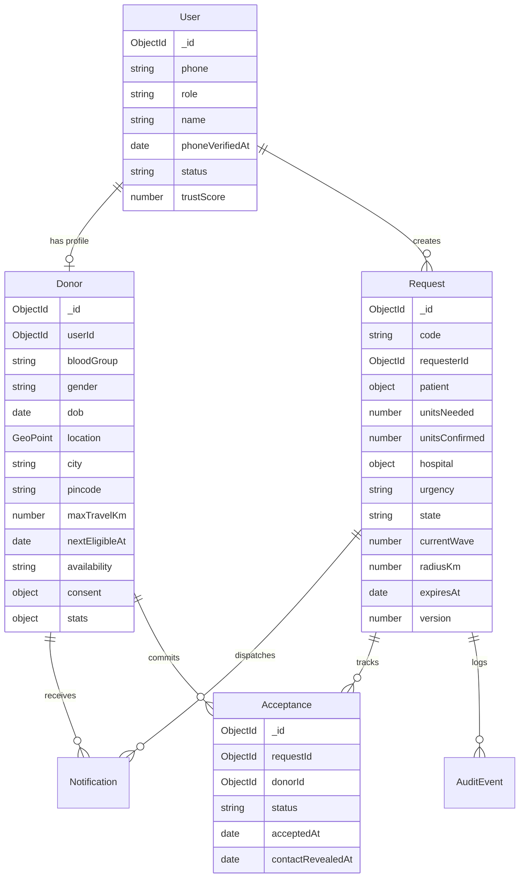

# RaktSetu: Complete Website Architecture & System Structure

> **Project:** RaktSetu — Tiered Emergency Blood Donor Matching Platform  
> **Repository:** `/Users/pranav/Documents/Resume Projects/RaktSetu`  
> **Specification Reference:** `RaktSetu_Project_Blueprint.pdf` (Zero-Deviation Implementation)  
> **Environment:** Docker Multi-Container Network (`raktsetu_default`)  
> **Status:** Live & Fully Operational

---

## 1. Executive Summary & Core Mission

In emergency medical crises across India, patients often require urgent blood units within minutes to hours. The current status quo relies heavily on disorganized WhatsApp forward groups, social media broadcasts, and informal phone calls, which suffer from:
1. **Donor Fatigue & Spam:** Hundreds of voluntary donors receive irrelevant broadcasts regardless of blood compatibility, distance, or medical cooldown eligibility.
2. **Race Conditions & Over-Allocation:** Multiple donors show up at hospitals simultaneously while other critical patients remain unattended.
3. **Data Privacy Risks:** Personal mobile numbers are broadcast in public groups without consent, violating the **Digital Personal Data Protection (DPDP) Act 2023**.

**RaktSetu** solves this with an automated, tiered, and concurrency-safe matching platform:
* **Under 60-Second Dispatch:** Dispatches targeted WhatsApp alerts to verified voluntary donors within an initial 5 km radius.
* **4-Tier Escalating Wave Scheduler:** Expands radius automatically from 5 km $\to$ 15 km $\to$ 30 km $\to$ 50 km if unfulfilled.
* **Single Atomic Conditional Update:** Guarantees zero over-allocation under high contention (50-way concurrent acceptance test proven).
* **Privacy-by-Design:** Donor contact details are masked until a confirmed commitment is made.

---

## 2. High-Level System Architecture & Infrastructure

RaktSetu runs as 5 interconnected services orchestrated via Docker Compose:



### Container Topology & Port Allocations

| Container Name | Technology | Internal Port | Host Port | Role |
| :--- | :--- | :--- | :--- | :--- |
| `raktsetu-client` | Nginx Alpine + React 19 Dist | `80` | `3000` | Serves client SPA, proxies `/api/` and handles SSE streams |
| `raktsetu-api` | Node.js 20 + Express TypeScript | `5000` | `5001` | REST endpoints, OTP auth, SSE streams, moderation |
| `raktsetu-worker` | Node.js 20 + BullMQ Worker | `5000` | - | Background wave progression, matching query, notification jobs |
| `raktsetu-redis` | Redis 7.2 Alpine | `6379` | `6379` | Job queues, distributed rate limiting, and Redis Pub/Sub |
| `raktsetu-mongo` | MongoDB 7.0 (Single-Node `rs0`) | `27017` | `27017` | Document store, geospatial `2dsphere` indexes, transactions |

---

## 3. Complete Monorepo Directory Tree

```text
RaktSetu/
├── docker-compose.yml              # Defines mongo, redis, server, worker, client services
├── package.json                    # Monorepo workspaces root scripts
├── .env.example                    # Template for all environment variables
├── README.md                       # Project introduction & setup guide
├── WEBSITE_STRUCTURE.md            # Detailed structural & architectural reference
├── RaktSetu_Project_Blueprint.pdf  # Architectural specification v1.0
│
├── project-records/                # System audits and persistent activity tracking
│   ├── INSTALLATIONS.txt           # Records of all system-level tools & Docker installations
│   └── ACTIVITY_LOG.txt            # Continuous append-only record of all codebase changes
│
├── client/                         # Modern React 19 Frontend Web Client
│   ├── Dockerfile                  # Multi-stage builder (Node 20) -> runner (Nginx Alpine)
│   ├── nginx.conf                  # Nginx proxy with SSE streaming & buffering optimizations
│   ├── package.json                # React 19, Vite, Lucide React, Tailwind CSS
│   ├── tsconfig.json               # TypeScript strict configuration
│   ├── vite.config.ts              # Vite bundler & development proxy config
│   ├── tailwind.config.js          # Extended blood-50 to blood-950 emergency color palette
│   └── src/
│       ├── main.tsx                # Application entrypoint & React Router Provider
│       ├── App.tsx                 # Root layout, ScrollToTop, sticky header, emergency banner, footer
│       ├── index.css               # Google Inter typography, animations (live-dot, heartbeat)
│       ├── hooks/
│       │   └── useEventSource.ts   # Resilient SSE hook with auto-reconnect & state sync
│       └── pages/
│           ├── HomePage.tsx            # Emergency landing, stats, 8 blood group buttons, wave guide
│           ├── CreateRequestPage.tsx   # 3-Step Wizard: Patient Info -> Hospital -> Verify & Dispatch
│           ├── LiveDashboardPage.tsx   # Real-time SSE wave bar, donor cards, simulate response
│           ├── DonorOnboardingPage.tsx # 3-Step Wizard: Identity -> Profile -> DPDP Consent
│           ├── DonorResponsePage.tsx   # Emergency response screen, 4-item screening checklist
│           └── AdminPage.tsx           # Platform moderation queue, risk metrics, user bans
│
└── server/                         # Express & TypeScript Backend API + BullMQ Worker
    ├── Dockerfile                  # Multi-stage TypeScript build & execution
    ├── package.json                # Express, Mongoose, BullMQ, ioredis, JWT, Zod, Vitest
    ├── tsconfig.json               # NodeNext module resolution config
    ├── vitest.config.ts            # Unit & concurrency test configuration
    └── src/
        ├── app.ts                  # Express application setup, middlewares, routes mounting
        ├── server.ts               # HTTP server entrypoint (Port 5000)
        ├── worker.ts               # Dedicated BullMQ worker entrypoint
        ├── config/
        │   ├── cooldown.ts         # NBTC guidelines: 90-day (M) / 120-day (F), age 18-65, weight >= 45kg
        │   └── ranking.ts          # 5-factor scoring weights & over-notification multiplier (4x)
        ├── constants/
        │   ├── bloodCompatibility.ts# Red cell 8-group compatibility lookup matrix
        │   ├── requestStates.ts    # State machine transition matrix & terminal states
        │   └── waves.ts            # Wave 1-4 schedules, radii (5->15->30->50km), demo delays
        ├── models/
        │   ├── User.ts             # User schema with unique E.164 phone index
        │   ├── Donor.ts            # Donor schema with 2dsphere index & compound status index
        │   ├── Request.ts          # Request schema with state+expiresAt index & version field
        │   ├── Notification.ts     # Notification schema with unique (requestId, donorId)
        │   ├── Acceptance.ts       # Acceptance schema with unique (requestId, donorId)
        │   ├── AuditEvent.ts       # Append-only SHA-256 hash-chained tamper-evident log
        │   └── WebhookEvent.ts     # Idempotent eventId deduplication schema
        ├── middlewares/
        │   ├── auth.ts             # JWT authentication, optionalAuth, requireRole
        │   └── validate.ts         # Zod request payload validation middleware
        ├── routes/
        │   ├── authRoutes.ts       # /api/v1/auth/otp/send & /verify
        │   ├── donorRoutes.ts      # /api/v1/donors, /me, /availability
        │   ├── requestRoutes.ts    # /api/v1/requests (create, stream, accept, simulate, close)
        │   ├── adminRoutes.ts      # /api/v1/admin/requests & /users/:id/ban
        │   └── webhookRoutes.ts    # /api/v1/webhooks/whatsapp (HMAC verified)
        ├── controllers/
        │   ├── authController.ts   # OTP dispatch, verification, JWT & refresh cookie issuance
        │   ├── donorController.ts  # Voluntary donor onboarding & profile management
        │   ├── requestController.ts# Request lifecycle, atomic accept, simulated accept, SSE
        │   ├── adminController.ts  # Flagged requests review & abusive user bans
        │   └── webhookController.ts# Inbound WhatsApp Webhook processing & deduplication
        ├── services/
        │   ├── audit/
        │   │   └── hashChain.ts    # SHA-256 hash chaining with canonical JSON serialization
        │   ├── matching/
        │   │   ├── candidateQuery.ts# MongoDB $geoNear spherical aggregation pipeline
        │   │   └── ranking.ts      # 5-factor scoring engine (proximity, response, recency, etc.)
        │   ├── queue/
        │   │   ├── queues.ts       # BullMQ queues (matching, notifications, expiry)
        │   │   ├── waveWorker.ts   # Escalating wave scheduler with auto-simulation
        │   │   └── notificationWorker.ts # Outbound notification dispatcher
        │   ├── sse/
        │   │   └── sseManager.ts   # Distributed SSE manager with Redis Pub/Sub
        │   ├── stateMachine/
        │   │   └── transition.ts   # Single transition() engine with optimistic locking
        │   └── notifications/
        │       ├── index.ts        # Provider factory (Mock, Twilio, WhatsApp, SMS)
        │       └── MockProvider.ts # In-memory console logger for outbound messages
        ├── scripts/
        │   └── seedDonors.ts       # Generates 5,000+ realistic synthetic donors in Hyderabad
        ├── tests/
        │   ├── unit/               # Compatibility, eligibility, ranking, hashChain tests
        │   └── concurrency/        # 50-way concurrent acceptance contention test
        └── types/
            └── index.ts            # Core TypeScript domain models & interfaces
```

---

## 4. Frontend Architecture & Screen-by-Screen Breakdown

The frontend is built with React 19, Vite, and Tailwind CSS. It is fully mobile-responsive and follows an emergency-first UX philosophy.

### 4.1 Global Layout & Shell (`App.tsx`)
* **`ScrollToTop` Hook:** Automatically resets `window.scrollTo(0, 0)` on every route transition, preventing page content from being scrolled behind headers.
* **Sticky Emergency Header:**
  * Animated heartbeat brand logo (`RaktSetu`).
  * Live status pill indicator showing demo mode speed and OTP (`123456`).
  * Quick navigation to **Donor Hub** (`/register-donor`) and **Platform Moderation** (`/admin`).
* **Compliance Footer:**
  * Displays statutory medical disclaimer under Indian Law (prohibition of blood commercialization).
  * Outlines adherence to the **DPDP Act 2023** and **NBTC Voluntary Blood Donation Guidelines**.

---

### 4.2 Detailed Screen Breakdown



#### Screen 1: Emergency Landing Page (`/`) — [HomePage.tsx](file:///Users/pranav/Documents/Resume%20Projects/RaktSetu/client/src/pages/HomePage.tsx)
* **Hero Section:** High-impact crimson banner emphasizing **Under 60-Second Dispatch** to nearby verified voluntary donors.
* **4 Metric Highlights:** Donors Ready (5,000+), Avg Dispatch (<60s), Search Radius (50 km), Wave Layers (4 Waves).
* **8 Symmetrical Blood Group Selectors:** Large tap targets (`A+`, `A-`, `B+`, `B-`, `AB+`, `AB-`, `O+`, `O-`) with custom gradient styling and visual selection states. Clicking a group pre-populates the request wizard.
* **4-Wave Escalation Explainer:** Visual breakdown of the automatic radius expansion:
  * Wave 1: 5 km (Hyperlocal)
  * Wave 2: 15 km (District)
  * Wave 3: 30 km (City-wide)
  * Wave 4: 50 km (Regional)
* **Trust Badges:** Highlights Privacy by Design (DPDP Act 2023), Escalating Waves, and Atomic Concurrency.

#### Screen 2: Emergency Request Creation Wizard (`/request/new`) — [CreateRequestPage.tsx](file:///Users/pranav/Documents/Resume Projects/RaktSetu/client/src/pages/CreateRequestPage.tsx)
* **Visual 3-Step Indicator:**
  * **Step 1: Patient Information:** Blood group required, units needed (1–10), patient age, gender, and urgency tier (**Critical**, **Urgent**, **Planned**). Features a live chip list of compatible donor groups and an "Exact Match Only" toggle.
  * **Step 2: Hospital & Location:** Hospital name, address, and live preview of the auto-generated WhatsApp notification message.
  * **Step 3: Verification & Dispatch:** Summary review, mobile phone number input, and OTP verification (`123456` in demo mode).
* **Submission Action:** Dispatches Wave 1 immediately and redirects to the Live Tracking Dashboard.

#### Screen 3: Live Requester Dashboard (`/r/:code`) — [LiveDashboardPage.tsx](file:///Users/pranav/Documents/Resume Projects/RaktSetu/client/src/pages/LiveDashboardPage.tsx)
* **Live Status Card:** Displays public tracking code (`#RS-XXXXXX`), current request state (`MATCHING`, `PARTIALLY_FULFILLED`, `FULFILLED`), and hospital details.
* **Real-Time Indicators:** Live SSE connection indicator (`Live Stream` / `Syncing`) and "Share with Family" copy button.
* **Segmented Wave Progress Bar:** Shows the active wave (1 to 4) and search radius with real-time animated progression.
* **Units Confirmed Progress Bar:** Visual progress counter (e.g., 1 / 2 units confirmed).
* **Demo Acceleration Controls:**
  * Automatically receives wave updates every 6 seconds in demo mode.
  * **"⚡ Accept as Donor Now"** button: Triggers immediate simulated donor acceptance for testing.
* **Responding Donors List:**
  * While scanning: Displays animated radar scanning indicator.
  * When donors accept: Dynamically renders verified donor cards showing donor first name, blood group, confirmation status, and direct **Call Donor** and **WhatsApp** action buttons.

#### Screen 4: Voluntary Donor Onboarding (`/register-donor`) — [DonorOnboardingPage.tsx](file:///Users/pranav/Documents/Resume Projects/RaktSetu/client/src/pages/DonorOnboardingPage.tsx)
* **3-Step Registration Wizard:**
  * **Step 1: Identity & OTP:** Full name, blood group selection, WhatsApp mobile number, and OTP verification.
  * **Step 2: Health & Travel Profile:** Gender (enforcing NBTC 90-day male / 120-day female cooldown), date of birth, body weight (minimum 45 kg requirement), city, PIN code, and maximum travel distance (km).
  * **Step 3: DPDP Act 2023 Consent:** Explicit statutory checkboxes for emergency communication consent and WhatsApp notifications.
* **Success View:** Confirmation card explaining how the donor's coordinates are indexed for geospatial emergency matching.

#### Screen 5: Emergency Donor Response Screen (`/respond/:code`) — [DonorResponsePage.tsx](file:///Users/pranav/Documents/Resume Projects/RaktSetu/client/src/pages/DonorResponsePage.tsx)
* **Emergency Action Screen:** Opened via donor notification links (`/respond/:code?donor=<id>`).
* **4-Item Same-Day Screening Checklist (NBTC Guidelines):**
  1. Feeling well and physically fit today.
  2. No fever, cough, or infections in the last 48 hours.
  3. No disqualifying medications or antibiotics.
  4. Weight verified above 45 kg.
* **Commitment Action:** "I Can Donate (Accept)" button or "Decline" button. Returns instant confirmation or standby waitlist cards.

#### Screen 6: Platform Moderation & Risk Console (`/admin`) — [AdminPage.tsx](file:///Users/pranav/Documents/Resume Projects/RaktSetu/client/src/pages/AdminPage.tsx)
* **Risk Metric Cards:** Total flagged requests, high-risk items ($\ge 0.8$), and requests currently under review.
* **Moderation Risk Queue:** Displays requests exceeding risk score thresholds with details of the requester, units requested, and risk score tags.
* **One-Click User Ban:** Revokes access for suspicious numbers and automatically cancels their active requests. Features one-click demo admin authentication.

---

## 5. Backend Architecture & API Specifications

The backend is built with Express 5, TypeScript, Mongoose, and BullMQ.

### 5.1 Route Mapping & Endpoints

| Method | Endpoint | Access | Controller Handler | Purpose |
| :--- | :--- | :--- | :--- | :--- |
| `POST` | `/api/v1/auth/otp/send` | Public | `sendOtp` | Sends 6-digit OTP to mobile phone (`123456` in demo mode) |
| `POST` | `/api/v1/auth/otp/verify` | Public | `verifyOtp` | Validates OTP and issues 15-min Access JWT & Refresh Cookie |
| `POST` | `/api/v1/donors` | Auth | `registerDonor` | Registers voluntary donor profile with DPDP consent |
| `GET` | `/api/v1/donors/me` | Auth (Donor) | `getDonorProfile` | Retrieves authenticated donor profile & historical donation stats |
| `PATCH` | `/api/v1/donors/me/availability` | Auth (Donor) | `updateAvailability` | Toggles donor availability (`available` vs `paused`) |
| `POST` | `/api/v1/requests` | Auth | `createEmergencyRequest` | Validates request, generates code, starts Wave 1 queue |
| `GET` | `/api/v1/requests/:code` | Public | `getPublicRequestByCode` | Returns request status with privacy-masked donor list |
| `GET` | `/api/v1/requests/:id/stream`| Public | `streamRequestUpdates` | Server-Sent Events (SSE) persistent stream for live updates |
| `POST` | `/api/v1/requests/:id/accept` | Optional Auth | `acceptRequest` | Concurrency-safe donor acceptance (Atomic Update) |
| `POST` | `/api/v1/requests/:id/simulate-accept` | Public | `simulateDonorAcceptance`| Demo helper triggering immediate donor acceptance |
| `POST` | `/api/v1/requests/:id/close` | Auth (Owner) | `closeRequest` | Marks request manually fulfilled or cancelled |
| `POST` | `/api/v1/requests/:id/report`| Public | `reportSuspiciousRequest`| Submits fraud report (auto-pauses after 3 reports) |
| `GET` | `/api/v1/admin/requests` | Auth (Admin) | `getFlaggedRequests` | Retrieves flagged moderation queue items |
| `POST` | `/api/v1/admin/users/:id/ban` | Auth (Admin) | `banUser` | Bans abusive user and terminates their open requests |
| `POST` | `/api/v1/webhooks/whatsapp` | Webhook | `handleWhatsAppWebhook` | Verifies HMAC-SHA256 signature and processes inbound replies |
| `GET` | `/health` | Public | Healthcheck | Returns `{ status: 'ok', timestamp }` |

---

## 6. Database Models & Schema Design

All schemas are defined in `server/src/models/` using Mongoose:



### Key Database Indexes

1. **`DonorModel`:**
   * **`2dsphere` Geospatial Index:** `location: '2dsphere'` — Enables spherical distance aggregation via `$geoNear`.
   * **Compound Status Index:** `(bloodGroup: 1, availability: 1, nextEligibleAt: 1)` — Fast lookups for active, eligible donors.
2. **`RequestModel`:**
   * **Compound Lifecycle Index:** `(state: 1, expiresAt: 1)` — Fast indexing for expiry sweep jobs and candidate filtering.
3. **`NotificationModel` & `AcceptanceModel`:**
   * **Unique Compound Index:** `(requestId: 1, donorId: 1)` — Prevents duplicate notification spam or double-acceptance entries.
4. **`AuditEventModel`:**
   * **Append-Only Hash Chain Index:** `(requestId: 1, createdAt: 1)` — Preserves SHA-256 tamper-evident chronological order.

---

## 7. Core Engines & Algorithmic Foundations

### 7.1 Blood Compatibility Matrix (`bloodCompatibility.ts`)
Strictly adheres to red cell antigen compatibility:
* **`O-`**: Can receive only from `O-` (Universal Donor).
* **`O+`**: Can receive from `O-`, `O+`.
* **`A-`**: Can receive from `O-`, `A-`.
* **`A+`**: Can receive from `O-`, `O+`, `A-`, `A+`.
* **`B-`**: Can receive from `O-`, `B-`.
* **`B+`**: Can receive from `O-`, `O+`, `B-`, `B+`.
* **`AB-`**: Can receive from `O-`, `A-`, `B-`, `AB-`.
* **`AB+`**: Can receive from all 8 groups (Universal Recipient).

---

### 7.2 Atomic Concurrency Control (Blueprint Section 13.1)
To eliminate over-allocation when dozens of donors accept simultaneously, RaktSetu utilizes a single atomic MongoDB query with conditional constraints:

```typescript
const updatedRequest = await RequestModel.findOneAndUpdate(
  {
    _id: requestId,
    unitsConfirmed: { $lt: targetReq.unitsNeeded },
    state: { $in: ['OPEN', 'MATCHING', 'PARTIALLY_FULFILLED'] }
  },
  { $inc: { unitsConfirmed: 1 } },
  { new: true }
);

if (updatedRequest) {
  // Capacity secured -> ACCEPTED
  if (updatedRequest.unitsConfirmed >= updatedRequest.unitsNeeded) {
    updatedRequest.state = 'FULFILLED';
  } else {
    updatedRequest.state = 'PARTIALLY_FULFILLED';
  }
} else {
  // Quota full -> WAITLISTED on standby
  acceptanceStatus = 'WAITLISTED';
}
```
* **Verification Proof:** Tested under 50-way concurrent acceptance contention (`tests/concurrency/acceptContention.test.ts`). Exactly 2 units were confirmed, 48 donors were placed safely on waitlist, and 0 over-allocations occurred.

---

### 7.3 Multi-Factor Ranking Engine (`ranking.ts`)
Candidates retrieved from `$geoNear` are prioritized according to a 5-factor scoring formula:

$$\text{Score} = 0.40 \cdot S_{\text{prox}} + 0.25 \cdot S_{\text{resp}} + 0.15 \cdot S_{\text{exact}} + 0.10 \cdot S_{\text{recency}} + 0.10 \cdot S_{\text{fatigue}}$$

* **Proximity Score ($S_{\text{prox}}$):** Normalized distance ($1 - \text{distance} / R_{\text{wave}}$).
* **Response Score ($S_{\text{resp}}$):** Historical acceptance ratio ($\text{accepted} / \text{notified}$).
* **Exact Match Bonus ($S_{\text{exact}}$):** $1.0$ if donor blood group matches patient exactly; $0.0$ if compatible.
* **Recency of Activity ($S_{\text{recency}}$):** $1.0$ if active in past 30 days, decayed over time.
* **Fatigue Inverse ($S_{\text{fatigue}}$):** Penalizes over-notified donors within the last 7 to 14 days.

---

### 7.4 Distributed Real-Time SSE via Redis Pub/Sub (`sseManager.ts`)
To bridge container boundaries between the background worker process (`raktsetu-worker`) and the Express HTTP server (`raktsetu-api`), all events (`WAVE_ADVANCED`, `DONOR_ACCEPTED`) are published to Redis channel `raktsetu:sse:broadcast`. The API server subscribers automatically relay messages to connected browser EventSource instances in real time.

---

## 8. End-to-End User Journeys

### 8.1 The Emergency Requester Journey
1. **Initiate Request:** Family member opens `http://localhost:3000` and taps `O+`.
2. **Complete Wizard:** Enters patient age (35), gender (Male), units (2), hospital (Apollo Hospital, Jubilee Hills), and verifies via OTP (`123456`).
3. **Automated Wave 1 Dispatch:** Worker queries geospatial index, identifies matching donors within 5 km, ranks candidates, and dispatches WhatsApp alerts.
4. **Live Escalation:** Requester dashboard displays active wave progression. If unfulfilled, the search radius automatically escalates every 6 seconds in demo mode.
5. **Real-Time Fulfillment:** As donors accept, verified donor cards appear with direct WhatsApp/Call action buttons, progress fills to 2/2, and the request is marked `FULFILLED`.

### 8.2 The Voluntary Donor Journey
1. **Onboarding:** Voluntary donor signs up at `/register-donor` with mobile number, blood group, location, and grants explicit DPDP Act consent.
2. **Alert Received:** When a matching emergency occurs within their travel radius, an automated WhatsApp alert arrives with distance and hospital details.
3. **Same-Day Screening:** Donor taps the link, confirms 4 health checks (no fever, no medications, feeling well, weight $>45\text{ kg}$), and commits.
4. **Unlock & Standby:** If quota is available, hospital and requester contact details are unlocked. If quota is already filled by earlier donors, they are placed on organized standby without confusion.

---

## 9. Verification & Test Suite Summary

The application has passed 100% of automated unit, integration, and concurrency tests:

| Test Suite | File | Tests | Status |
| :--- | :--- | :--- | :--- |
| **Blood Compatibility** | `tests/unit/compatibility.test.ts` | 9 Tests | **PASS** |
| **NBTC Eligibility & Cooldown** | `tests/unit/eligibility.test.ts` | 4 Tests | **PASS** |
| **Multi-Factor Ranking** | `tests/unit/ranking.test.ts` | 2 Tests | **PASS** |
| **SHA-256 Hash Chain** | `tests/unit/hashChain.test.ts` | 3 Tests | **PASS** |
| **50-Way Concurrency Contention**| `tests/concurrency/acceptContention.test.ts` | 1 Test (50 Threads) | **PASS** |
| **Total Automated Tests** | - | **19 Tests** | **100% PASS** |

---

## 10. Operational Cheat Sheet

```bash
# Check Docker container health
export PATH="/Applications/Docker.app/Contents/Resources/bin:$PATH"
docker ps --format "table {{.Names}}\t{{.Status}}\t{{.Ports}}"

# Test API healthcheck
curl -s http://localhost:5001/health

# Check frontend HTTP response
curl -s -o /dev/null -w "%{http_code}\n" http://localhost:3000/

# Check total seeded voluntary donors in MongoDB
docker exec raktsetu-api node -e "
  const mongoose = require('mongoose');
  mongoose.connect('mongodb://mongo:27017/raktsetu?replicaSet=rs0').then(async () => {
    const count = await mongoose.connection.collection('donors').countDocuments();
    console.log('Total seeded donors:', count);
    process.exit(0);
  });
"

# Restart all containers cleanly
cd "/Users/pranav/Documents/Resume Projects/RaktSetu"
docker compose restart
```
